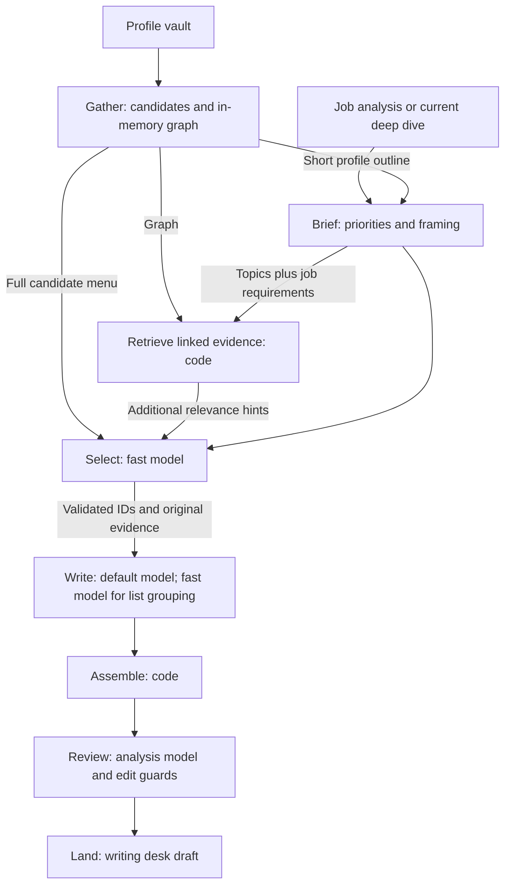

# Profile graph retrieval for CV generation

The profile map already represents a knowledge graph: notes are entities and
`contains`, `has`, `demonstrates`, `uses` and `certifies` are typed relationships.
CV generation now queries those relationships before Select chooses evidence.
The map remains the editable source of truth. No vector index, graph service,
extra model call, database migration or second copy of profile data is needed.

## Flow

1. Gather loads the profile-scoped vault and derives an in-memory graph from the
   same snapshot used to build the candidate menu.
2. Brief runs as before. Its named lead-with/emphasise topics and the strategy's
   must-have/nice-to-have requirements become retrieval queries.
3. A whole-name match or conservative word overlap seeds retrieval. Capability
   links lead to supporting evidence, narratives or certifications; ownership
   links lead back to the project and role. A named project also retrieves its
   own evidence. No arbitrary traversal through sibling projects or activities.
4. Select gets a bounded, additional data section with selectable handles,
   matching seed handles where available, relationship types and link provenance.
   Its complete candidate menu stays available. Existing ID validation, caps,
   chronological coverage, proof-status checks and writer fact checks still apply.
5. If the model cannot choose, graph matches supply a small, bounded activity
   ranking bonus to the existing rules fallback. They create no additional picks.

The Gather and Select logs record graph availability and matching topic counts.
Selection still stores original profile IDs, so writers retrieve the original
evidence, including outcome qualifications, rather than graph-generated claims.

Model roles resolve through each user's settings. In the observed run below,
Select and list grouping used Haiku; Brief, section writing and Review used Opus.
Graph construction and retrieval make no model call. Gather can still use the
existing job-analysis fallback when no usable strategy is available.

## Meaning and limits

- A graph hit is a relevance hint, **not** proof that a job requirement is met.
- `confirmed` records an owner decision. `exact` and `wikilink` are derived text
  links and remain labelled as such.
- `uses` supports the linked narrative; it never attaches its tool to every
  achievement underneath the role. `certifies` remains certification evidence,
  not employment experience.
- Matching follows names and words, not semantic embeddings. Different wording
  with no overlapping terms can be missed. The full menu remains available to
  the selector's language reasoning; an empty graph result is not a skills gap.
- Retrieval examines at most 24 distinct topics, alternating Brief priorities
  (lead-with, then emphasise) with job requirements (must-have, then nice-to-have).
  A shorter list leaves its spare slots for the other. It returns at most 40
  selectable notes per topic, filtering against the candidate menu before this
  limit. The prompt shows at most eight selectable matches per topic and 16,000
  characters of valid JSON. These are retrieval bounds, not candidate pruning.
- Identity and preferences are excluded. Profile contact details are scrubbed
  from graph text. Archived projects and their evidence are excluded. Graph IDs
  stay internal; only the existing menu's handles enter the additional prompt section.

## Freshness and maintenance

The projection is rebuilt on each Gather, so profile edits and confirmed/rejected
link decisions are reflected on the next run. Its canonical fingerprint includes
note text and typed edges with provenance and is part of the CV input hash.
Even a link-only edit therefore invalidates selection reuse. The selection
pipeline version is also bumped for the initial rollout.

Implementation: `src/modules/knowledge-graph/graph.ts` holds projection and
retrieval; `src/modules/cv-generation/graph-retrieval.ts` adapts them to CV
handles. Keep these modules pure and profile-local. Add new relationship traversal
rules explicitly, with tests that prevent evidence spreading to siblings.

## Operating decision: observe the current flow (2026-11-22)

Keep the deployed flow as it is while the owner uses it and checks accuracy over
time. This is an observation period, not a new tuning round. No model defaults,
prompts, selection budgets, graph traversal or evidence-menu limits change as
part of this decision. Monitoring uses the existing run logs and manual source
checks; no automatic evaluation or background monitoring has been added.

**What is established.** PR #464 added graph-assisted retrieval to Select while
retaining the full candidate menu. Run `cmwrr4yyi000007jqygh1upwn` on 2026-11-22
loaded 337 graph notes and found related notes for 10 of 17 topics. It completed
in 2 minutes 26 seconds with 12 calls and an estimated total cost of $0.66;
Select used Haiku and cost under $0.01. These are observations from one profile
and job, not expected results for other users. Matching-topic counts are neither
an accuracy score nor proof that graph retrieval changed a selection.

**What is not established.** There is no controlled graph-on/graph-off comparison
demonstrating better evidence recall or lower cost. The graph adds prompt context
today; it does not replace or shrink Select's menu. Model variation, profile
edits, job/strategy changes and different selections can all affect successive
CVs, so a better-looking rerun alone does not establish an improvement.

For a useful observation, retain the run ID/log and record:

| Check | What to record |
|---|---|
| Context | Date, deployed version, models, fresh/reused selection, and whether the profile, job or strategy changed. |
| Evidence selection | Which relevant evidence was kept or omitted; whether it was in the menu; and any visible relationship supporting it. |
| Fidelity | Whether source results, baselines, periods, units, qualifiers and project/employer attribution survived Write and Review. |
| Concerns | Whether a warning reflects missing profile data, evidence omitted from selection, or a false warning against information already present. Verify against the source before changing the profile. |
| Practical output | Necessary manual edits and any layout problem in the rendered CV/PDF. |
| Spend | Stage costs, tokens, calls, retries and duration from the log. A failed retry or a different model can affect cost independently of retrieval. |

Known observations to watch, without changing behavior here: a paid-media-only
budget qualifier becoming an unrestricted budget claim; Review saying location
is absent when it is in the header; and graph-linked evidence still being marked
uncovered by the rules fallback. The current log does not expose every retrieval
path, so an individual pick cannot always be attributed to the graph.

**Deferred cost option, not implemented.** Retrieve a bounded shortlist through
graph links and lexical fallback, preserve chronological coverage, and let the
fast model select from that shortlist. Expand to the full menu when coverage is
weak. This could reduce Select input tokens, but it needs evidence-recall checks
across unrelated synthetic profiles before replacing the current menu. Select
already costs under $0.01 in the observed run; larger savings would require
separately evaluating writer/Review context size or cheaper model choices. No
saving or accuracy level is promised.

Revisit tuning when source-checked observations establish a repeatable defect,
or when a deliberate controlled evaluation is approved. Keep any future change
profile-agnostic; do not add exceptions for this owner's employers or history.
